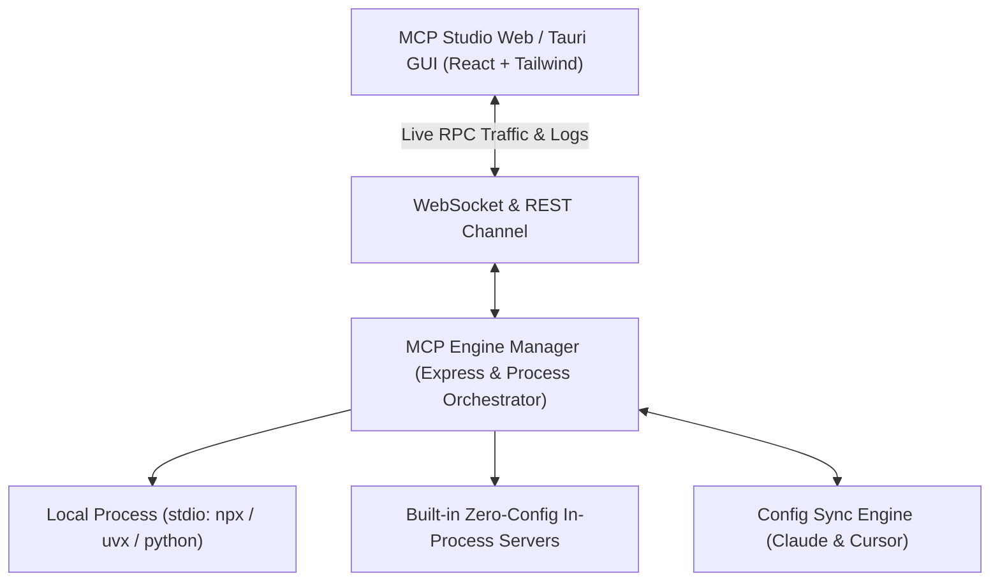

<p align="center">
  
  <a href="https://m8ven.ai/mcp/yaromir-anokhin-mcp-studio-tjv602?s=readme"></a>
  
  
  
</p>

<h1 align="center">⚡ MCP Studio</h1>

<p align="center">
  <strong>The Visual Postman & DevTools Suite for Anthropic's Model Context Protocol (MCP)</strong><br />
  Inspect tools, test JSON-RPC in real time, debug stdio servers, and 1-click sync with Claude Desktop and Cursor.
</p>

<p align="center">
  <a href="https://m8ven.ai/mcp/yaromir-anokhin-mcp-studio-tjv602?s=readme"></a>
</p>

[](https://m8ven.ai/mcp/yaromir-anokhin-mcp-studio-tjv602?s=readme)


<p align="center">
  <a href="#-quick-start">Quick Start</a> •
  <a href="#-key-features">Key Features</a> •
  <a href="#-why-mcp-studio">Comparison</a> •
  <a href="#-marketplace">Marketplace</a> •
  <a href="#-sponsorship--donations">Sponsorship Tiers</a> •
  <a href="#-contributing">Contributing</a>
</p>

---

## 🌟 Why MCP Studio?

The **Model Context Protocol (MCP)** is revolutionizing how AI models interact with databases, tools, and systems. But building and debugging MCP servers until now meant:
- ❌ Editing cryptic JSON config files in terminal editors.
- ❌ Stdio pipes crashing silently with zero stack traces or logs.
- ❌ Manually crafting JSON-RPC 2.0 curl/stdin payloads to test a single tool.
- ❌ Manually syncing configuration across Claude Desktop, Cursor, and Windsurf.

**MCP Studio solves this completely.** It is an interactive, visual workbench ("Postman for AI") built specifically for developers working with LLM tools and agents.

---

## 🚀 Key Features

### 1. ⚡ Interactive Tool Runner ("Postman for MCP Tools")
- **Dynamic Form Generation**: Reads tool `inputSchema` and automatically renders input fields for strings, numbers, booleans, enums, and objects.
- **Raw JSON Request Mode**: Toggle to a syntax-highlighted editor for direct JSON-RPC testing.
- **Real-Time Execution**: One-click `tools/call` with round-trip latency measurement (ms) and error diagnostics.
- **Export Snippets**: Copy as cURL, Node.js, or Python code with one click.

### 2. 🤖 AI Agent Tool Simulator
- Test how autonomous agents make decisions using your MCP tools.
- Step-by-step reasoning and tool call trace visualizer.
- Supports **Zero-Config Simulated Heuristic Mode** (works instantly out-of-the-box) or your own **OpenAI / Ollama / Claude API Key**.

### 3. 📡 Live JSON-RPC 2.0 Traffic Inspector
- Real-time stream of all bidirectional packets (`initialize`, `tools/list`, `tools/call`, `resources/list`, `prompts/list`).
- Packet timing analysis (latency in ms) and direction indicator (`IN` / `OUT`).
- One-click HAR/JSON export for bug reports and team debugging.

### 4. 🔄 1-Click Config Sync (Claude Desktop & Cursor)
- Auto-detects `claude_desktop_config.json` and `~/.cursor/mcp.json` on **Windows, macOS, and Linux**.
- Visual diff viewer before writing.
- **Zero Data Loss Guarantee**: Automatic timestamped backups created before any config modification.

### 5. 🛒 Built-in MCP Server Marketplace
- One-click install for **20+ popular MCP servers**:
  - `Filesystem`, `GitHub`, `PostgreSQL`, `SQLite`, `Brave Search`, `Fetch`, `Memory Graph`, `Docker`, `Puppeteer`, and more.
- Guided environment variable setup (API keys, connection strings).

### 6. 🌐 Remote Cloud SSE & HTTP Transport
- Full support for cloud-hosted MCP servers via **Server-Sent Events (SSE)**.
- Auto-discovers POST endpoints, handles auth Bearer tokens, and transparently bridges remote RPC packets.
- Test servers running in Docker, Fly.io, Cloudflare, or remote microservices without installing local CLI binaries.

### 7. 🧪 Postman-style Test Suites & Assertions
- Save tool calls into persistent **Test Scenarios and Suites**.
- Define assertions: **Latency thresholds (ms)**, **status checks**, and **response substring / JSON schema matches**.
- 1-click **Run Suite** with real-time pass/fail scorecards and latency metrics.
- Export test suites as JSON and generate ready-to-use **GitHub Actions CI/CD workflows**.

### 8. 📦 Zero-Dependency Built-in Servers
- Ships with pre-loaded mock servers (`System Diagnostics`, `Filesystem Safe Explorer`, `Web & Search Simulator`).
- Test tool schemas immediately without installing external npm or python packages!

---

## 📊 Comparison: MCP Studio vs Alternatives

| Feature | Manual JSON Editing | Official CLI Inspector | ⚡ MCP Studio |
| :--- | :---: | :---: | :---: |
| **Visual Form from Schema** | ❌ None | ⚠️ Basic HTML | ✅ Rich Form + Raw JSON |
| **Remote Cloud SSE Transport** | ❌ None | ⚠️ Limited | ✅ Full SSE + Stream Inspector |
| **Test Suites & Assertions** | ❌ None | ❌ None | ✅ Postman-style Runner + CI/CD |
| **Live JSON-RPC Monitor** | ❌ None | ⚠️ Console text | ✅ Filterable Traffic Grid + Latency |
| **Claude & Cursor 1-Click Sync** | ❌ Manual copy-paste | ❌ None | ✅ Auto-detect + Safe Backup |
| **AI Agent Tool Calling Loop** | ❌ None | ❌ None | ✅ Built-in Trace Simulator |
| **Curated 1-Click Store** | ❌ None | ❌ None | ✅ 20+ Preconfigured Servers |
| **1-Click Launch (npx)** | ❌ None | ⚠️ Needs flags | ✅ `npx mcp-studio` |

---

## ⚡ Quick Start

### Prerequisites
- Node.js 18+ (tested on Node v20 / v22)
- npm or yarn or pnpm

### Launch Instantly via NPX (Zero Clone)

```bash
npx mcp-studio
```
*Opens MCP Studio directly in your default browser!*

---

### Or Run from Source (Development)

```bash
# 1. Clone the repository
git clone https://github.com/Yaromir-Anokhin/mcp-studio.git
cd mcp-studio

# 2. Install dependencies
npm install

# 3. Launch both backend engine and web UI
npm start
```

Open **`http://localhost:3000`** in your browser.  
The backend engine runs on `http://localhost:3001` with active WebSocket links.

> **Windows Users**: You can also simply double-click `start.bat`!

---

## 🛠️ Architecture



---

## 💖 Sponsorship & Donations

MCP Studio is 100% free, open-source software licensed under MIT.  
If MCP Studio saves you hours of debugging or powers your company's AI stack, consider supporting the development:

| Tier | Price | Perks |
| :--- | :---: | :--- |
| **☕ Coffee Supporter** | `$5 / mo` | GitHub Sponsor badge on profile, name in `README.md` Backers list, Discord access. |
| **🚀 Pro Developer** | `$15 / mo` | Early access to native Desktop binary builds (Tauri v2), priority roadmap requests, custom server templates. |
| **🏢 Company / Startup** | `$50 / mo` | **Company Logo + Link** prominently featured at top of `README.md` and inside the app, private Slack/Discord technical advisory. |

👉 **[Sponsor on GitHub Sponsors](https://github.com/sponsors/Yaromir-Anokhin)** • **[Support via Buy Me a Coffee](https://buymeacoffee.com)**

---

## 🤝 Contributing

Contributions are warmly welcomed! Please read our [CONTRIBUTING.md](CONTRIBUTING.md) to get started.

1. Fork the repo (`gh repo fork`)
2. Create your feature branch (`git checkout -b feature/amazing-feature`)
3. Commit your changes (`git commit -m 'Add amazing feature'`)
4. Push to the branch (`git push origin feature/amazing-feature`)
5. Open a Pull Request

---

## 📄 License

Distributed under the **MIT License**. See [LICENSE](LICENSE) for more information.
